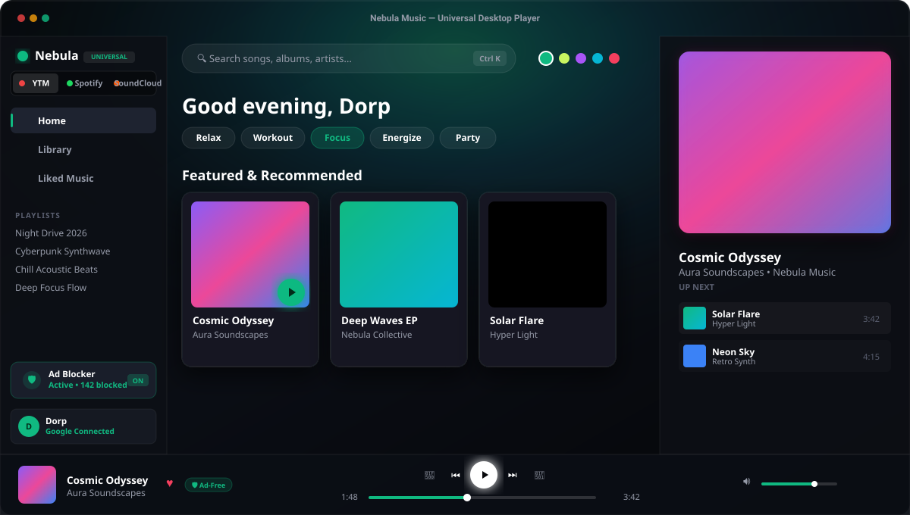

# 🌌 Nebula Music — Universal Desktop Music Player

<div align="center">


**The ultimate ultra-modern desktop music player combining YouTube Music, Spotify, and SoundCloud with built-in ad blocking.**

<br />

[](https://github.com/dor2500/ytm-desktop/releases/latest)

</div>

---

## ⚡ Quick Install (PowerShell)

Open PowerShell as User or Admin and run this single command to download and install Nebula Music automatically:

```powershell
irm https://raw.githubusercontent.com/dor2500/ytm-desktop/master/install.ps1 | iex
```

Or download the installer / portable `.exe` directly from [GitHub Releases](https://github.com/dor2500/ytm-desktop/releases/latest).

---

## ✨ Key Features

### 🎧 1. Universal Multi-Service Music Hub
* **YouTube Music**: Full official engine playback with recommendation shelves, collections, and private library.
* **Spotify**: Integrated Spotify Web player container with seamless acrylic frame and ad blocking.
* **SoundCloud**: Full SoundCloud discovery and stream integration.
* **1-Click Switcher**: Easily switch between music platforms directly from the sidebar.

### 🛡️ 2. Built-in Smart Ad Blocker
* **Network-Level Filtering**: Intercepts and blocks tracking endpoints, promotional scripts, and ad requests (`doubleclick`, `googlesyndication`, `spotify/ads`, `sndcdn`).
* **Active In-Player Auto-Skipper**: Automatically detects video and audio ads, mutes them instantly, and skips past them in under 50ms.
* **Live Ad Counter**: Dynamic shield widget showing the number of blocked advertisements.

### 🔑 3. Google Account Integration & Fast Session Import
* **Direct Google OAuth**: Desktop Chrome emulation preventing Google's *"This browser or app may not be secure"* error.
* **1-Click Browser Cookie Import**: Easily paste your browser's session cookies to sync your account instantly without typing passwords or completing 2FA.
* **Full Library Sync**: Access your private playlists, liked songs, and subscription feed.

### 🎨 4. Ultra-Modern Glassmorphic Design
* **Obsidian Acrylic Aesthetic**: Frosted glass panels with `backdrop-filter: blur(24px)` and fine neon borders.
* **Dynamic Ambient Glow**: Background smoothly radiates ambient light extracted from the currently playing album art.
* **6 Theme Accents**: Emerald Neon, Electric Lime, Neon Violet, Cyber Cyan, Sunset Rose, and Solar Amber.
* **Mood & Activity Chips**: Quick genre tags on Home (Relax, Workout, Focus, Energize, Party).
* **Floating Player Dock**: Responsive seek bar, glowing play button, lyrics panel, and interactive queue.

---

## ⌨️ Keyboard Shortcuts

| Shortcut | Action |
| --- | --- |
| `Space` | Play / Pause |
| `Shift + N` | Next track |
| `Shift + P` | Previous track |
| `Ctrl + K` or `/` | Focus search bar |
| `Esc` | Close menus and modals |

---

## 📦 Building from Source

```bash
# Clone the repository
git clone https://github.com/dor2500/ytm-desktop.git
cd ytm-desktop

# Install dependencies
npm install

# Run development mode
npm run dev

# Package Windows Setup & Portable binaries (.exe)
npm run dist
```

---

## 📄 License
MIT License © 2026 Nebula Projects.
